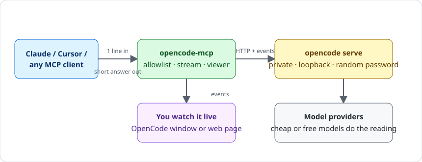
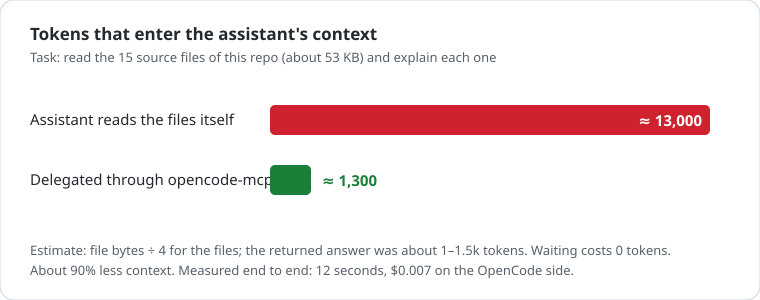

# opencode-mcp

**Give your AI assistant a cheap helper for the heavy reading, and keep your expensive context for thinking.**

`opencode-mcp` is a small MCP server that lets Claude, ChatGPT, Cursor, or any MCP client hand work to
[OpenCode](https://opencode.ai). OpenCode reads the files and runs the commands on a cheap or free model, and your
assistant gets back only a short answer. Zero npm dependencies (Node 20+), one command to install.



## Why use it

- **Saves tokens.** Reading a project eats the assistant's context. Delegated, only the short answer enters it. In our
  test that was about 13,000 tokens of source against about 1,300 tokens of answer (roughly 90% less).
- **Saves time.** The wait costs nothing. Start several sessions with `wait_seconds: 0`, keep working, then collect each
  answer with `opencode_result`. Finishing is detected from OpenCode's event stream, so there is no polling loop burning
  tokens.
- **Quick to set up.** One command, no config files to write by hand ([Install](#install)).
- **You can watch.** OpenCode's own terminal window opens on the same session, as if you had started it yourself.
- **Safe by default.** Only folders you authorize, a private loopback server with a random password, read-only viewer
  ([Security model](#security-model)).

## Real numbers

Measured on this repo with real OpenCode sessions (not a simulation):

| Task | What the assistant's context got | Time | OpenCode-side cost |
| --- | --- | --- | --- |
| Summarize all 15 source files (53 KB) | ≈ 1,300 tokens (the answer) instead of ≈ 13,000 (the files) | ≈ 12 s | ≈ $0.007 |
| "Understand this large monorepo and summarize it" | a short summary | ≈ 20 s | ≈ $0.005 (24,144 in / 1,328 out tokens) |



How to read these honestly:

- The 13,000 figure is an estimate (file bytes ÷ 4), not a tokenizer count. The point is the ratio, not the digit.
- OpenCode's own token counter adds up every step, including context it resends, so it is larger than the unique text.
  That cost is paid by the cheap model, not by your assistant's context.
- Time is not saved because OpenCode is faster than your assistant. It is saved because work runs in parallel while
  you or the assistant do something else, and because waiting uses no tokens.
- Tiny tasks (a one-line answer you already know) are not worth delegating. The win grows with the amount of reading.

## Tools

| Tool | What it does |
| --- | --- |
| `opencode_status` | Check that OpenCode is reachable; returns its version, whether the server is private or external, the authorized directories, and the live-view URL. |
| `opencode_list_sessions` | List top-level sessions newest first, limited to authorized directories; filter by `directory` or `search`, default 20, at most 100. |
| `opencode_create_session` | Create a session in an authorized directory, optionally with `title`, `model`, `agent`, and a first `prompt`; runs in the background, no TUI. |
| `opencode_send` | Send an instruction to an existing session (history is kept), optionally switching `model` first; `delivery` is `steer` (inject into the running turn) or `queue` (run after it). |
| `opencode_result` | Wait for the session's current turn to finish and return the latest answer, tools used, and outcome. |
| `opencode_history` | Read a session's conversation, newest first by default; default 10, at most 50, optionally filtered by `type`; long texts are cut. |
| `opencode_get_session` | Show one session: directory, model, agent, cost, tokens, last outcome, and whether it is running now. |
| `opencode_list_providers` | List the model providers OpenCode knows and whether each is active. |
| `opencode_list_models` | List models as `provider/model` refs with variants and context size; filter by text or `provider`, default 40, at most 200. |
| `opencode_list_agents` | List the visible agents (modes such as build or plan) in a project. |
| `opencode_switch_model` | Change the model for a session's later turns; validates the model and variant against the available models. |
| `opencode_switch_agent` | Change the agent for a session's later turns. |
| `opencode_interrupt` | Stop the session's running turn; the session and its history remain. |
| `opencode_rename_session` | Change a session's title. |
| `opencode_fork_session` | Copy a session's conversation into a new session, leaving the original untouched. |
| `opencode_delete_session` | Permanently delete a session and its child sessions; requires `confirm: true`. |
| `opencode_changes` | Show the file changes the session has made so far. |
| `opencode_permissions` | List the permission requests a session is waiting on, or answer one with `once`, `always`, or `reject`. |

`create` and `send` wait up to `wait_seconds` (default 120, capped by `maxWaitSeconds`); `0` returns at once and leaves
the turn running for `opencode_result`. Models are written `provider/model` or `provider/model#variant`.

Sessions are stored by OpenCode itself. A session created here shows up in `opencode session list` and can be resumed
in the terminal with `opencode -s <id>` (verified), and the other way around.

## Watching it work

Sending an instruction opens a view of the session once per session (`viewer` and `off` excepted):

- `terminal` (default): on Windows, OpenCode's own terminal window is started against the same private server and
  session, so it looks as if you had started it yourself. The server password reaches the window through its
  environment only.
- `browser`: a read-only live page in the default browser. This is also the fallback on other platforms, if `opencode`
  cannot be found, or if the terminal window fails to start.

The page lives at `http://127.0.0.1:<viewerPort>/<token>/` (index of authorized sessions) and
`.../<token>/s/<id>` (one session, streamed from OpenCode's events). It is loopback-only, every URL carries a random
token that exists only while this process runs, the `Host` header must match, and sessions outside the authorized
directories are not served. `opencode_status` returns the index URL as `liveView`; `create` and `send` return the
session page as `watchLive`.

Watching costs the assistant nothing: the window and the page talk to this process, not to the model. Finishing is
detected from OpenCode's event stream, so a reply comes back the moment the turn ends, and a long wait uses no model
tokens. If the stream drops, it falls back to polling.

## Install

You need [Node 20+](https://nodejs.org) and [OpenCode](https://opencode.ai) installed and logged in to a provider.

```bash
git clone https://github.com/muhamedbeshir/opencode-mcp
cd opencode-mcp
node bin/opencode-mcp.mjs install --allow /path/to/your/project
```

`install` does everything in one step: writes the settings file, authorizes the folders you pass with `--allow`
(default: the current folder), and registers the server with every client it finds (Claude Code, Claude Desktop,
Cursor). Choose clients with `--client claude-code,claude-desktop,cursor`. Then restart the client and ask it to call
`opencode_status`. Repeat `--allow` for more folders. Without at least one authorized folder every project tool
refuses to work.

If no client is found it prints the JSON snippet to paste into your client's MCP settings.

### Let your AI agent install it

Tell your agent: *"Install https://github.com/muhamedbeshir/opencode-mcp by following its
[llms-install.md](llms-install.md)."* The file has exact commands and a checklist the agent can run on its own.

`setup` alone (settings and folders, no client registration) still works:
`node bin/opencode-mcp.mjs setup --allow <dir>`. It writes `%APPDATA%\opencode-mcp\config.json` (keeps existing values,
only adds), finds `opencode`, and creates an HTTP bearer token once.

## Configuration

Settings come from the config file, and environment variables win over it. `OPENCODE_MCP_CONFIG` moves the file
itself.

| Setting | Environment variable | Config key | Default |
| --- | --- | --- | --- |
| Authorized project directories | `OPENCODE_MCP_ALLOWED_DIRS` (`;` on Windows, `:` elsewhere) | `allowedDirs` | `[]` — nothing is authorized |
| OpenCode executable | `OPENCODE_MCP_BIN` | `bin` | `null` — found with `where` / `which` |
| Use an OpenCode server you already run | `OPENCODE_MCP_SERVER_URL` | `serverUrl` | `null` — start a private server |
| Password for that server | `OPENCODE_MCP_SERVER_PASSWORD` | `serverPassword` | `null` |
| HTTP transport port | `OPENCODE_MCP_HTTP_PORT` | `httpPort` | `47600` |
| HTTP bearer token | `OPENCODE_MCP_TOKEN` | `httpToken` | `null` — `setup` generates 32 random bytes |
| Longest tool wait | — (file only) | `maxWaitSeconds` | `900` |
| Live view mode | `OPENCODE_MCP_VIEWER` | `viewer` | `terminal` (`terminal` \| `browser` \| `off`) |
| Live view port | `OPENCODE_MCP_VIEWER_PORT` | `viewerPort` | `47601` — a free port if busy |
| Extra accepted `Host` headers | `OPENCODE_MCP_ALLOWED_HOSTS` (comma-separated) | `allowedHosts` | `[]` — loopback names always work |
| Extra accepted `Origin` headers | `OPENCODE_MCP_ALLOWED_ORIGINS` (comma-separated) | `allowedOrigins` | `[]` |

`serverUrl` and `serverPassword` must both be set to skip the private server; otherwise the server starts its own.

## Connect a client

### Claude Desktop (stdio)

```powershell
node bin/opencode-mcp.mjs register claude-desktop
```

This adds an `opencode` entry to `%APPDATA%\Claude\claude_desktop_config.json`, keeps everything else, and saves a
`.bak` copy first. Or add it by hand and restart Claude Desktop:

```json
{ "mcpServers": { "opencode": { "command": "node", "args": ["D:\\opencode-mcp\\bin\\opencode-mcp.mjs"] } } }
```

### Claude Code (stdio)

```powershell
claude mcp add opencode -- node D:\opencode-mcp\bin\opencode-mcp.mjs
```

### Cursor, Windsurf, Cline, and other stdio clients

Use the same command and args as above in the client's MCP settings.

### ChatGPT and other remote clients (HTTP)

These need a URL, so run the HTTP transport and put an HTTPS tunnel in front of it.

```powershell
node bin/opencode-mcp.mjs http       # http://127.0.0.1:47600/mcp
node bin/opencode-mcp.mjs token      # the bearer token to give the client
```

Expose it with a tunnel you trust (for example `cloudflared tunnel --url http://127.0.0.1:47600`), then allow that host:
`OPENCODE_MCP_ALLOWED_HOSTS=your-name.trycloudflare.com`. In ChatGPT, add a custom MCP connector with the tunnel URL
plus `/mcp` and the bearer token. The connector UI depends on the plan; this part could not be tested from here.

Any other client: POST JSON-RPC 2.0 to `/mcp` with `Authorization: Bearer <token>`. Replies are plain JSON (no SSE).

## Security model

- Only directories from `allowedDirs` (and their children) can be used. The check is applied to the directory of
  every session a tool touches, so a session id from another project is refused. Paths are resolved first
  (`..`, symlinks, short names, case).
- By default the server starts its **own** `opencode serve` on `127.0.0.1` with a random port and an in-memory
  password, and stops it on exit. Nothing is written to disk or logged.
- The HTTP transport listens on loopback only, requires a bearer token (24+ characters, constant-time compare), checks
  `Host` and `Origin` (DNS rebinding), caps bodies at 1 MB, and refuses to start without a token. `/health` is
  unauthenticated and returns nothing sensitive.
- The live viewer is read-only, loopback-only, serves GET only, requires its random path token on every URL, checks
  `Host`, sends a restrictive CSP, and hides sessions outside the authorized directories. The token is regenerated
  each run and is never written to disk.
- Existing configs are never overwritten: `setup` merges, `register` backs up first. The settings file is written with
  owner-only permissions where the OS supports it.
- Deleting needs `confirm: true`. Permission requests from OpenCode stay paused until a client answers them.

An authorized directory means the assistant can make OpenCode read and edit files there and run commands, within
OpenCode's own permission rules. Authorize only projects you are happy to hand over.

## Troubleshooting

**The server does not appear in Claude Desktop after a restart.** Quit Claude Desktop completely, including the tray
icon, and reopen it. If it still does not show, validate `%APPDATA%\Claude\claude_desktop_config.json` — a JSON error
disables every server in the file — and check that the `command`/`args` path exists (`node bin/opencode-mcp.mjs path`
prints the entry point). `register claude-desktop` can add the entry again; it keeps the rest and saves a `.bak` first.

**A provider key expired, or the account has no credits.** The OpenCode error text comes back in the tool result and
the call is marked as an error. Refresh the provider with `opencode auth login`, then check
`opencode_list_providers` and `opencode_list_models`. Nothing is retried automatically.

**A session is running in another OpenCode process.** A session driven by an open TUI or another `opencode serve`
belongs to that process. This server runs its own private one and reads the stored history, so it cannot see a turn in
progress elsewhere. Wait until the session is idle, then continue it here; do not send to the same session from both
at once.

**A free model is rejected.** OpenCode itself refuses models that need a newer OpenCode, typically free-tier ones.
Upgrade OpenCode (`opencode upgrade`, or reinstall the package), then retry. The server passes OpenCode's error
through unchanged.

**The viewer window does not open.** The terminal window is Windows-only and needs a findable `opencode` (set
`OPENCODE_MCP_BIN` if `where opencode` fails); elsewhere, or if it cannot start, the page opens in the default
browser. If neither opens, the `watchLive` URL in the tool result still works when pasted into a browser.
`"viewer": "off"` disables both. If `viewerPort` is busy, the viewer picks a free port, so the port can differ from
the configured one.

## Limitations

- Turn completion is streamed (OpenCode events) with polling as a fallback. Long work: use a short `wait_seconds` and
  call `opencode_result` again. `wait_seconds` is capped at `maxWaitSeconds` (900 by default).
- Changing the model mid-session uses OpenCode's `switchModel`; models and variants come from `opencode_list_models`.
- Tested with a raw MCP client over stdio and HTTP and the real OpenCode `0.0.0-arabic-202610150110`. Claude Desktop,
  ChatGPT and the others speak the same standard protocol (2025-06-18, 2025-03-26, 2024-11-05) but were not driven
  from here.
- Tunnels for ChatGPT are your choice and your responsibility.

## Tests

```powershell
npm test            # unit: policy, model refs, turn reading, all 18 tools, HTTP security, SSE, viewer (no OpenCode needed)
npm run test:live   # real OpenCode: create, follow-up with history, model switch, fork, delete, refusal, async result
node test/http-live.mjs   # manual check of the HTTP transport against real OpenCode
```

`npm test` runs `test/unit.test.mjs` and `test/stream.test.mjs`. Set `OPENCODE_MCP_TEST_MODEL` /
`OPENCODE_MCP_TEST_MODEL_2` to models that work on your machine before `npm run test:live`.
